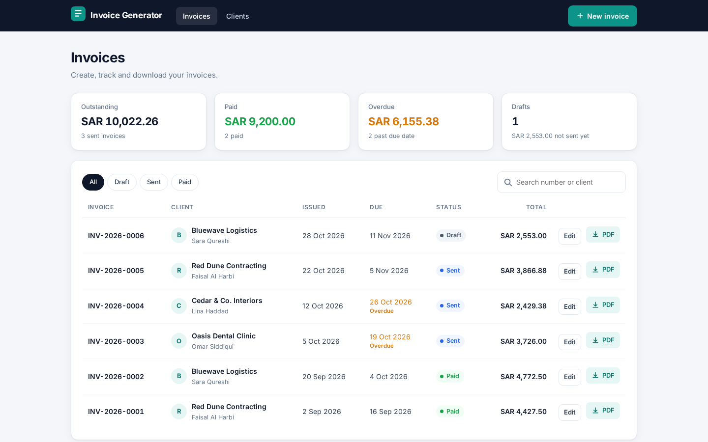
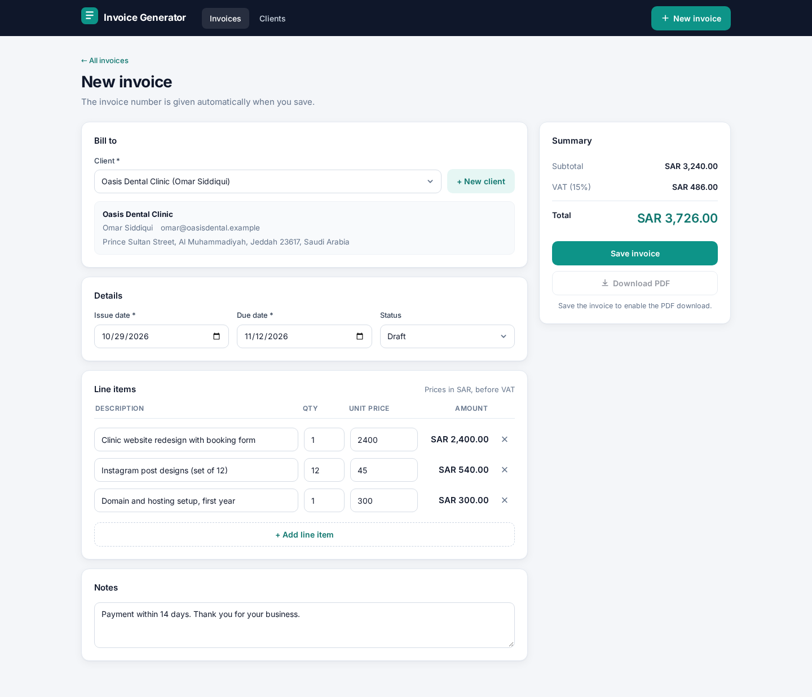
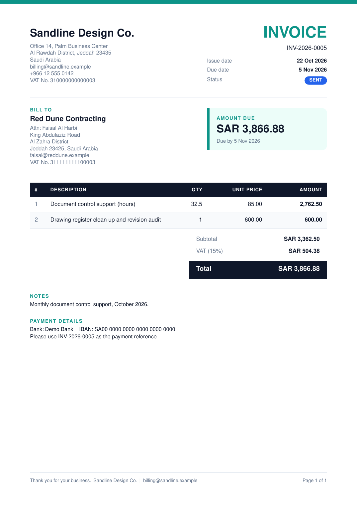
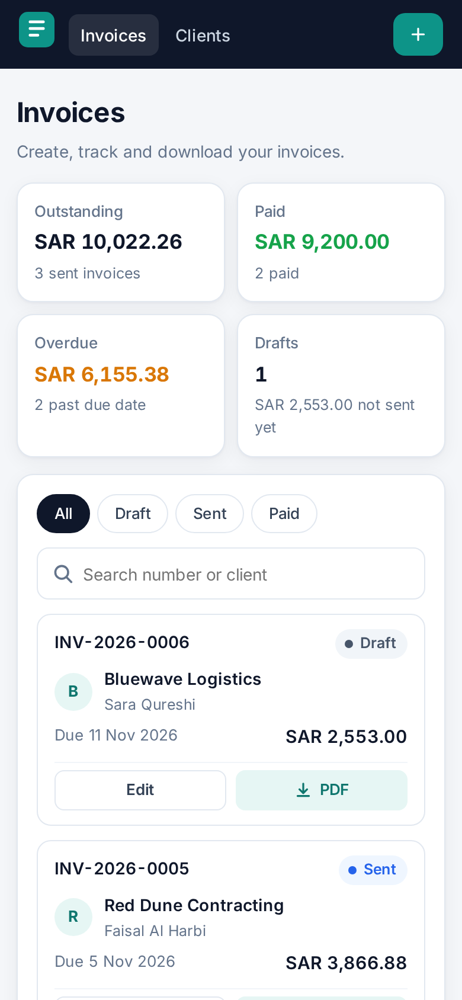
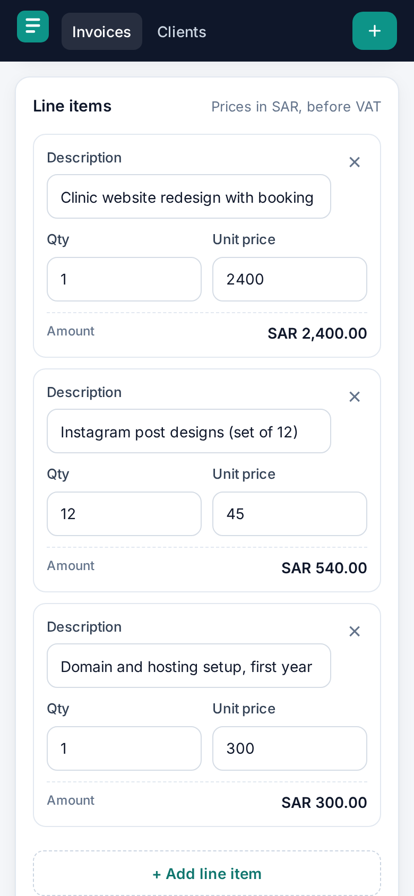

# Invoice Generator

Create clients and invoices in a clean web form, and download professional A4 PDF invoices with VAT, built with Node.js, Express, SQLite and PDFKit.

| Invoice list | New invoice form |
| --- | --- |
|  |  |

| Generated PDF (page 1) | Mobile list | Mobile line items |
| --- | --- | --- |
|  |  |  |

## Features

- **Clients:** create, edit, list, search and delete clients (name, company, email, address, VAT number). A client with invoices cannot be deleted by mistake.
- **Invoices:** automatic numbers like `INV-2026-0001` (the counter restarts every year), issue date, due date, client, line items and notes.
- **Statuses:** Draft, Sent and Paid, with overdue detection for sent invoices past their due date.
- **Exact money math:** every amount is stored in integer halalas (or cents). Totals are always calculated on the server, so a client cannot send its own total.
- **VAT:** 15% by default, configurable with `VAT_RATE`. Each invoice keeps the rate it was created with.
- **Currency:** set with `CURRENCY` (default `SAR`).
- **PDF download:** `GET /api/invoices/:id/pdf` streams a well designed A4 PDF with seller block, bill to block, items table, totals, notes, payment details and a footer with page numbers. Long invoices flow onto extra pages with the table header repeated.
- **Web app:** invoice list with summary cards, status filter chips and search; a form with dynamic line item rows and live totals; client picker with a quick add client dialog; save and download PDF buttons. Plain HTML, CSS and JavaScript, no framework, fully responsive.
- **Solid API:** input validation with zod and clear field errors, one central error handler, JSON 404 for unknown routes.
- **Seed data:** 4 fictional clients and 6 invoices so the app looks real on first run.
- **Tests:** 40 Jest and supertest tests covering money rounding, both APIs, validation and the PDF endpoint.

## Tech stack

| Part | Tool |
| --- | --- |
| Runtime | Node.js 18 or newer |
| Web server | Express 4 |
| Database | SQLite with better-sqlite3 |
| Validation | zod |
| PDF | PDFKit |
| Frontend | HTML, CSS and vanilla JavaScript |
| Tests | Jest and supertest |

## Getting started

```bash
git clone https://github.com/mohammadgulab/invoice-generator.git
cd invoice-generator
npm install
cp .env.example .env
npm run seed
npm start
```

Open http://localhost:3000 in your browser.

Run the tests:

```bash
npm test
```

For development with auto restart on file changes, use `npm run dev`.

## Environment variables

| Variable | Default | Description |
| --- | --- | --- |
| `PORT` | `3000` | Port the server listens on |
| `DB_FILE` | `./data/app.db` | Path of the SQLite database file |
| `CURRENCY` | `SAR` | Currency code shown on invoices |
| `VAT_RATE` | `15` | VAT rate in percent, for example `15` or `5` |
| `SELLER_NAME` | `Sandline Design Co.` | Your business name on the PDF |
| `SELLER_ADDRESS` | fictional Jeddah address | Address lines, separated with `\|` |
| `SELLER_EMAIL` | `billing@sandline.example` | Contact email on the PDF |
| `SELLER_PHONE` | `+966 12 555 0142` | Contact phone on the PDF |
| `SELLER_VAT` | `310000000000003` | Your VAT registration number |
| `SELLER_BANK` | `Demo Bank` | Bank name in the payment details |
| `SELLER_IBAN` | `SA00 0000 0000 0000 0000 0000` | IBAN in the payment details |

The default seller is a fictional company, so replace these values with your own details in `.env`.

## API endpoints

All responses are JSON, except the PDF. Money values are integers in minor units (halalas or cents).

| Method | Path | Description |
| --- | --- | --- |
| GET | `/api/health` | Health check |
| GET | `/api/config` | Currency, VAT rate and seller name used by the frontend |
| GET | `/api/clients` | List clients, optional `?q=` search |
| POST | `/api/clients` | Create a client |
| GET | `/api/clients/:id` | Get one client |
| PUT | `/api/clients/:id` | Update a client |
| DELETE | `/api/clients/:id` | Delete a client (409 if it has invoices) |
| GET | `/api/invoices` | List invoices with client names, optional `?status=`, `?client_id=`, `?q=` |
| GET | `/api/invoices/stats` | Count and total per status, plus overdue |
| POST | `/api/invoices` | Create an invoice, number and totals are calculated |
| GET | `/api/invoices/:id` | Get an invoice with its items and client |
| PUT | `/api/invoices/:id` | Update an invoice and recalculate totals |
| PATCH | `/api/invoices/:id/status` | Change only the status |
| DELETE | `/api/invoices/:id` | Delete an invoice and its items |
| GET | `/api/invoices/:id/pdf` | Download the PDF as `INV-....pdf` (add `?inline=1` to view in the browser) |

Example request to create an invoice:

```json
POST /api/invoices
{
  "client_id": 1,
  "issue_date": "2026-10-01",
  "due_date": "2026-10-15",
  "status": "Draft",
  "notes": "Thank you for your business.",
  "items": [
    { "description": "Landing page design", "quantity": 1, "unit_price": "1500.00" },
    { "description": "Support hours", "quantity": 2.5, "unit_price": "95" }
  ]
}
```

A validation error looks like this:

```json
{
  "error": "Validation failed",
  "details": [{ "field": "items.0.unit_price", "message": "Must be a positive amount with up to 2 decimals" }]
}
```

## How the totals work

1. Prices are parsed from text into integer halalas, so `19.99` becomes `1999` with no floating point noise.
2. Quantities can have up to 3 decimals. Each line is `quantity x unit price`, rounded half up to the nearest halala.
3. The subtotal is the sum of the lines. VAT is `subtotal x rate`, rounded half up.
4. The total is subtotal plus VAT. The browser uses the same math for the live preview, and the server always recalculates on save.

## Project structure

```
invoice-generator/
  src/
    app.js              Express app setup
    server.js           Starts the server
    config.js           Reads environment variables
    db.js               SQLite connection and schema
    money.js            Integer money math and formatting
    invoiceService.js   Invoice numbering, totals and queries
    validation.js       zod schemas
    errors.js           Error classes, error handler and 404
    pdf.js              A4 PDF invoice layout with PDFKit
    seed.js             Demo clients and invoices
    routes/
      clients.js        Clients CRUD
      invoices.js       Invoices CRUD, stats and PDF
      meta.js           Health and config
  public/
    index.html          Single page app shell
    app.js              Router, list, form and clients views
    money.js            Same totals math for live preview
    style.css           Responsive styles
  tests/
    helpers.js
    money.test.js
    clients.test.js
    invoices.test.js
    validation.test.js
    pdf.test.js
  docs/screenshots/
  .env.example
  package.json
  LICENSE
```

## Tests

```bash
npm test
```

```
Test Suites: 5 passed, 5 total
Tests:       40 passed, 40 total
```

What is covered:

- **Money math:** string to halala parsing, fractional quantities, half up rounding of lines and VAT, other VAT rates.
- **Clients API:** full CRUD, search, empty fields, 404s and the "client has invoices" guard.
- **Invoices API:** totals calculated on the server, yearly numbering, filters and search, update, status change, stats, delete, env based VAT and currency.
- **Validation:** missing fields, bad line items, negative prices, impossible dates, due date before issue date, unknown status, unknown client, broken JSON, unknown routes.
- **PDF:** returns `application/pdf`, starts with `%PDF`, correct download file name, inline mode, multi page invoices, JSON 404 for a missing invoice.

Every test runs on an in memory SQLite database, so your real data is never touched.

## License

MIT, see [LICENSE](LICENSE). Copyright (c) 2026 Mohammad Gulab.
